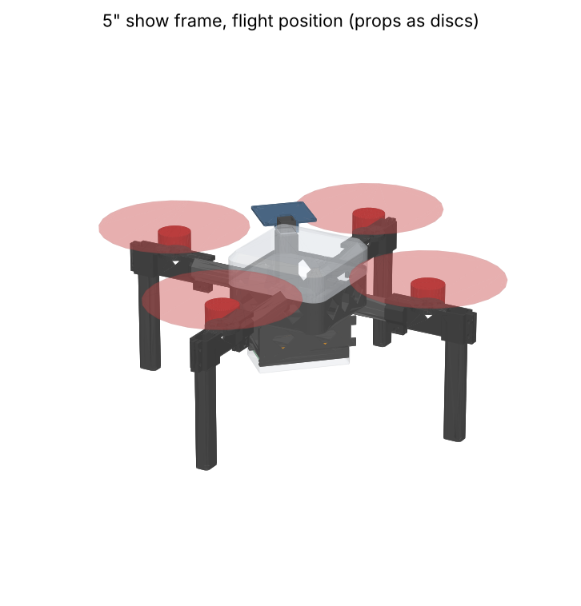
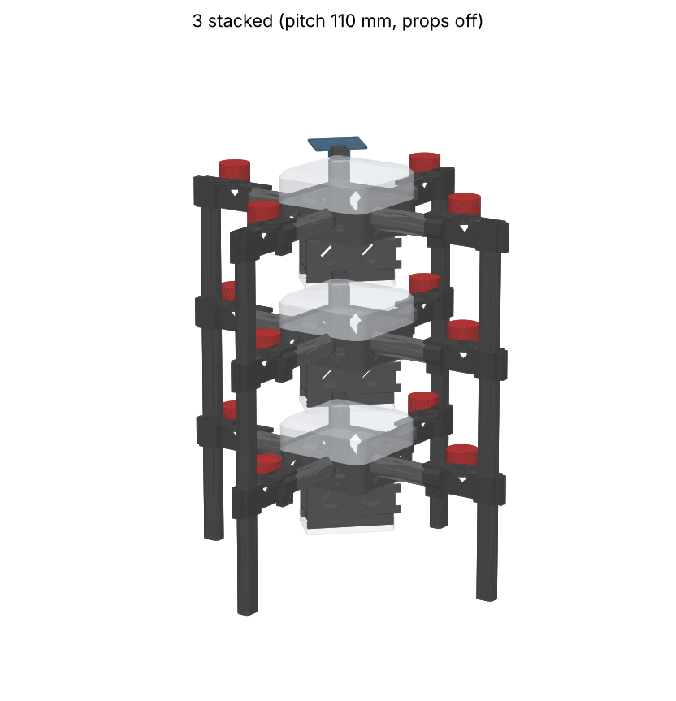
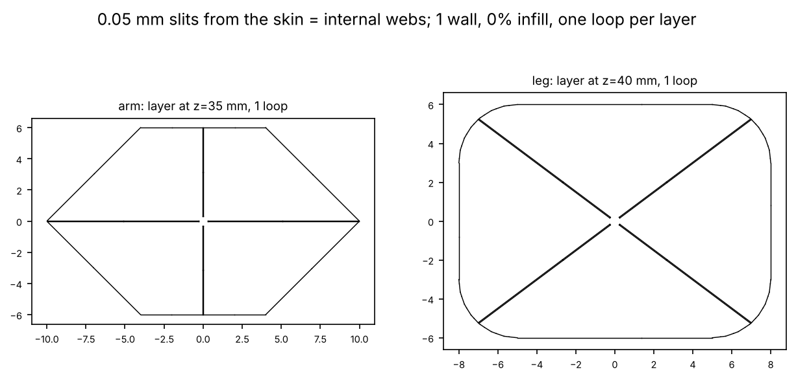
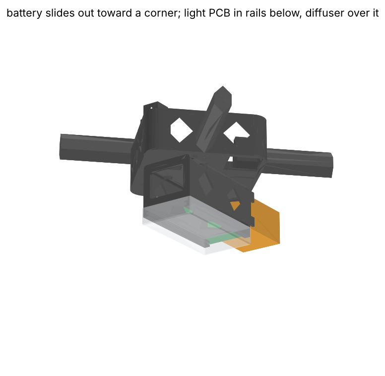
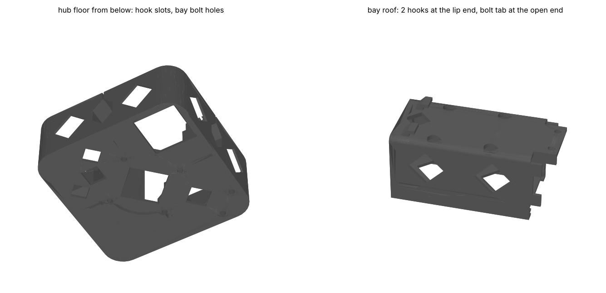

# 3D-printed 5" drone-show frame

A parametric [build123d](https://github.com/gumyr/build123d) model of a
stackable 5" show quad, based on the tall-legged, shell-covered show drones in
the reference photos. Iterate in PLA+, then reprint the same files in PA6-CF.




## Design rules (v3)

The parts follow the Eclipson / 3DLabPrint method:

1. **Web parts (arms, legs)** are solid prisms cut with **0.05 mm slits that
   start at the outer skin** and run toward the centre without ever meeting.
   With 1 wall and 0% infill, each layer is **one closed loop**: the nozzle
   follows the skin, goes into a slit, around its tip and back out. There is no
   travel or retraction inside a layer, and every slit becomes a double-line
   web fused to the skin. `frame.py` slices each web part and checks that every
   layer is a single loop.
2. **Nothing needs support.** Every surface is vertical or slopes at 45 deg or
   less. Arm pockets are hexagons with 45 deg ridges, horizontal bolt holes are
   teardrops, and the hub windows are diamonds. The hub no longer has lips:
   the top shell slips over the outside of its ring. `frame.py` was checked for
   downward faces steeper than 45 deg in print orientation and found none.
3. **Fittings (hub, motor pods)** take the bolts, so they are normal prints.
   They are thin-walled, and the arms and legs are held in them by pinch
   clamps. No bolt passes through a web part, because a hole would break its
   single loop. The motor plate runs back over the whole arm socket, so the
   pod sits on a flat face instead of the bare hex ridge, which lifted.
   The shaft hole only goes 5 mm below the motor plate (`MOTOR_SHAFT_CLR`)
   and ends in a 45 deg point, so the web under the motor stays one piece
   and the plate doesn't flex when the arm and leg are pulled apart.
4. **The top shell** is printed in vase mode.
5. **Battery bay**: a sleeve under the hub, directly beneath the FC. It hooks
   into the hub floor and bolts to it with its own two bolts. See below.
6. **GPS**: a hollow mast in one corner of the hub comes up through the top
   shell, and a cap with a receiver plate bolts onto it. See below.



## Layout

| Item | Value |
|---|---|
| Props / motor to motor | 5" / 240 mm |
| Prop tip gap / prop tip to shell face | 42.7 mm / 11.5 mm |
| Motors | RS2205: M3 on 16 mm and 19 mm diagonals (19 mm on the +45 deg one), 9 mm shaft hole; 3.6 mm motor plate, so use M3 x 6 |
| FC/ESC stack | 30.5 x 30.5 mm M3, rotated 45 deg, on 5 mm bosses on the hub floor (the same thickness as a 5 mm frame plate) |
| Body | 90 x 90 mm top shell, 28 mm tall, overlapping the hub ring by 4 mm; battery bay underneath; GPS cap on top |
| Arm | 12 x 20 mm hexagon (deep for vertical bending) with a + web, 71 mm long |
| Leg | 16 x 12 mm with an X web, 110 mm long, closed 0.8 mm foot |
| Ground clearance under the light diffuser | 38 mm |
| Stack pitch | 110 mm. Each leg runs up through its pod and stops 2 mm below the top; the foot of the drone above drops into that pocket and rests on the leg below. |

The FC is mounted rotated 45 deg, so it still sees a normal **X quad**
(ArduPilot `FRAME_CLASS=1`, `FRAME_TYPE=1`).

## Parts and print settings (`out/`)

| File | Qty | Orientation (as exported) | Settings | Est. g (PLA) |
|---|---|---|---|---|
| `arm.stl` | 4 | standing on end | 1 wall, 0% infill, 0 top, 0 bottom | ~4.4 |
| `leg.stl` | 4 | foot down | 1 wall, 0% infill, 0 top, 4 bottom (0.8 mm) | ~6.4 |
| `hub.stl` | 1 | as flown (floor on the bed) | 3 walls, 15% infill, no support | ~29 |
| `motor_pod.stl` | 4 | upside down, motor seat on the bed | 3 walls, 15-25% infill, no support | ~8.7 |
| `top_shell_vase.stl` | 1 | chamfer on the bed | spiral vase, 4 bottom layers | ~11 |
| `gps_cap.stl` | 1 | upside down, plate on the bed | 3 walls, 15% infill, no support | ~4 |
| `battery_bay.stl` | 1 | standing on the stop-lip end | 4 walls, 15% infill, no support | ~19 |
| `light_diffuser_vase.stl` | 1 | as exported (closed face on the bed) | spiral vase, 4 bottom layers, translucent | ~5 |

The frame totals about **149 g in PLA**, including the battery bay, the light
diffuser and the GPS mast and cap. `.step` files of every part and
`assembly.step` are included as well. Use your Eclipson Bambu profile for the
arms and legs, since it already handles the 0.05 mm slits.

## Assembly

1. Slide the arms into the hub sockets (15 mm) and the pod sockets (15 mm).
   Clamp each with an M3 x 16 bolt and nut through the teardrop hole in the
   clamp ears.
2. Push each leg up through its pod until the top is 2 mm below the pod top,
   then tighten the two M3 x 16 clamp bolts on the outboard ears.
3. Motors: 4x M3 x 6 from underneath the 3.6 mm motor plate.
4. FC stack: M3 bolts from underneath the hub, up through the floor and the
   four 5 mm bosses into the stack standoffs. These are the same bolts you'd
   use on a 5 mm carbon plate. Button heads, because they sit in clearance
   holes in the bay roof.
5. Motor wires run along the arms and into the hub through the diamond windows
   beside each socket.
6. Battery bay (see the picture below):
   1. Drop two M3 nuts into the hex pockets on the two bosses near the
      bay's open end, inside the hub.
   2. Route the ESC power lead down through the diamond hole near the
      lip end.
   3. Hold the bay about 3 mm toward its lip end from its final position,
      push its two roof hooks up through the slots in the hub floor, then
      slide it 3 mm toward its open end so the hooks catch on the floor.
   4. Put two M3 x 8 bolts up through the roof tab past the open end into
      the nuts. They're outside the bay, so a driver goes straight up beside
      it.
7. The top shell slips over the hub ring, and the GPS mast comes up through
   the square hole in its top.
8. The GPS cap slides over the mast neck, and one M3 x 20 bolt (and nut)
   goes across through the cap and the neck. The cap clamps the top shell
   down onto the mast shoulder, so the shell can't come off in flight.

## Battery bay





The bay is sized for the Ovonic 3S 2200 mAh pack (75 x 33 x 25 mm, +/-3 mm).
Its inside is 74 x 37 x 28 mm. It hangs directly under the FC stack and runs
along a diagonal, so the pack slides out toward a corner between two legs.
`frame.py` sweeps the worst-case 78 x 36 x 28 mm pack 90 mm out of the bay and
confirms it doesn't touch an arm, pod or leg.

* Leads first: a lip at the closed end stops the pack, and the XT60 lead exits
  through the lip opening.
* The pack sticks out 1 to 4 mm at the open end so you can grab it.
* Retention: run a velcro strap or rubber band across the open end, through
  the notches in the two side tabs.
* The bay hangs from the hub floor, not from the FC stack. The floor ties
  together the hub ring, the four arm sockets and the stack bosses, and the
  bay's 2.4 mm roof and 1.6 mm walls carry the pack up to its two hooks and
  two bolts.
* Changing the pack (`BATTERY_*` parameters) resizes the bay. The stacking
  clearance and ground clearance are printed when you run `frame.py`.

The bottom shell has been removed, because a pack can't slide out of a closed
cup. Its job is now done by the light diffuser below.

## Light PCB (under the battery)

The LEDs are on the bottom of the drone, where the audience sees them. The
light board slides into two C-channel rails under the battery bay, with its
LEDs facing down. A translucent vase-mode **diffuser** cup slips up over the
rails and covers the board. You can still slide the battery out above it
without touching the board.

* **Board:** 73 x 35 x 1.6 mm (`PCB_L`, `PCB_W`, `PCB_T`). `out/light_pcb_outline.dxf`
  has the board edge (layer `Edge.Cuts`) and the strips to keep LEDs out of
  (layer `KeepOut`), with the origin at the board centre, ready to import into
  KiCad.
* **Keep-outs:** 2 mm along both long edges, because the rail ledges cover the
  board edge above and below. Also 2 mm at the end that goes in first, against
  the rail stop.
* **Clearances:** 4 mm for top-side parts (connectors, driver) between the
  board and the bay floor, and 6 mm from the LEDs to the diffuser. Raise
  `DIFFUSER_GAP` for softer, more even light.
* **Loading:** slide the board in from the bay's open end until it hits the
  stop, then push the diffuser on. The diffuser's end wall keeps the board
  from sliding back out. Run the LED wires up past the open end of the bay
  into the hub.
* The rails have a constant profile along the bay, and the bay prints standing,
  so they print as plain walls with no support.

Adding the board and diffuser made the drone 13 mm taller, so the stack pitch
is now 110 mm (legs 110 mm). Stacked drones still have 7 mm between one
drone's diffuser and the top shell below.

## GPS

The GPS mast is part of the hub: a hollow square tube in the corner away
from the bay's hooks and bolts. Its cable runs down inside it and comes out
through a window near the floor, facing the FC. The cap's plate is the same
45 x 45 mm as the RTK GPS board (`rtk-gps`), with its four M3 holes on the
30.5 mm stack pattern and a cable hole over the mast.

* Mount the board on four M3 standoffs, about 5 mm or longer (the FC stack's 6 mm rubber ones work). Its bottom is flat, and
  the standoffs leave room to run the JST-GH cables back under the board into
  the cable hole.
* Turn the board so its bottom-right corner (the compass) is the corner
  farthest from the hub, away from the ESC and the battery leads.

* The plate sits just above the top shell, 52 mm above the hub centre and
  above the props, and outside the bay's footprint. So when drones are
  stacked the board doesn't hit the bay of the drone above. The board's
  tallest parts end about 30 mm below the drone above.
* For ArduPilot's GPS position offsets: the plate centre is 47 mm from the
  hub centre along the diagonal between two arms (the corner beside the
  bay, not over it), and its top is 52 mm above the hub's mid-plane. Measure
  from the FC to get the X, Y and Z for your build.
* The top shell hole is cut only through its 0.8 mm top (the 4 solid
  bottom layers as printed), so it still prints in vase mode. Check the
  slicer preview shows the hole.

## Regenerating

```sh
pip install -r requirements.txt
python frame.py    # STL + STEP into out/, clearances, masses, loop check
python render.py   # PNG previews and layer sections into out/
```

All dimensions are parameters at the top of `frame.py`. Keep `SLIT` equal to
the slit width your slicer profile is tuned for.

## Known limits / next iterations

* The masses are estimates (wall area times line width for the web parts,
  70% of the solid for the fittings), so weigh the first prints.
* Arms and legs print with their layers running across the bending load, the
  same compromise as the Eclipson wings. This is fine for show flying, but
  they will break in a crash, and they are the cheap parts to replace.
* Opposite arms are tied together only through the hub ring and the low ring
  under the stack. If the hub flexes in testing, the next step is a deeper
  centre cross.
* The diffuser is held by friction only.
* There's no mount yet for the GNSS antenna on the board's U.FL jack.
* The hub went from about 18 g to 29 g with the floor and the GPS mast.
