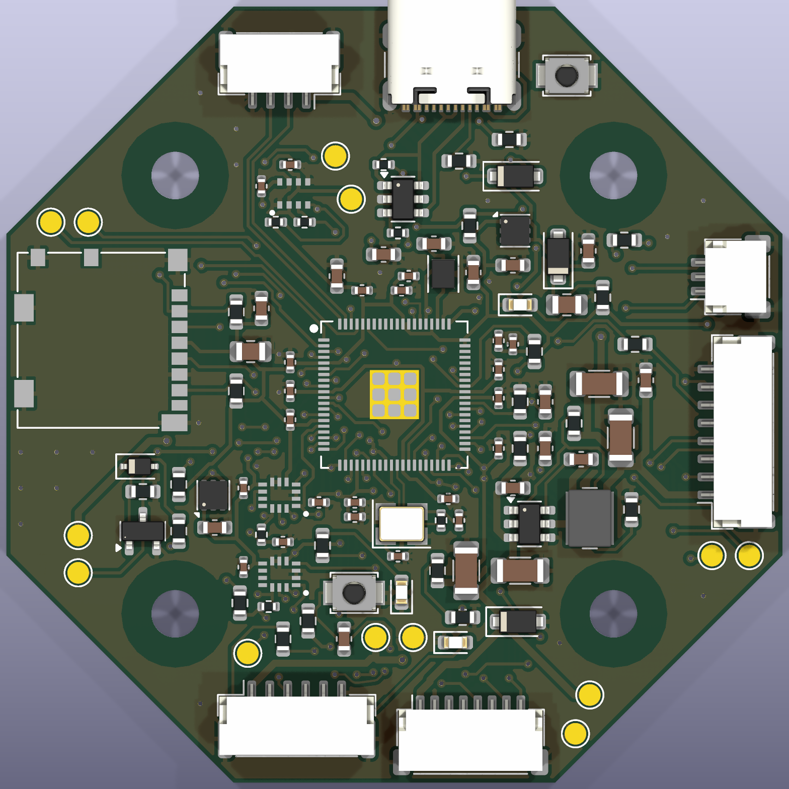
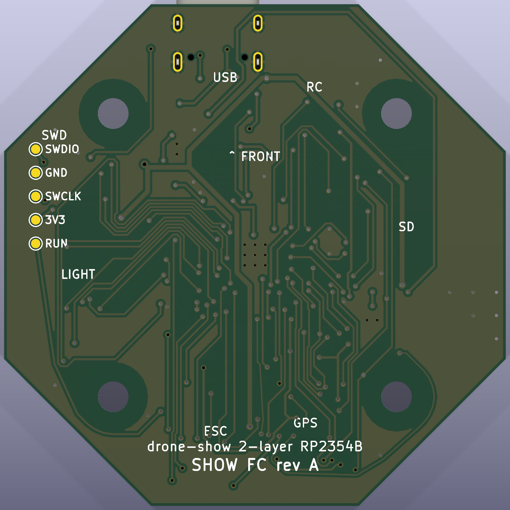

# Show FC: 2-layer flight controller for the drone show

A flight controller made for the show quad: RP2354B, two IMUs, a DPS368
barometer, microSD for logs and the show file, and ports for the RTK GPS
board, the light/Wi-Fi board, an RC receiver and the ESC. It is a redesign of
[OpenFC-Lite](https://github.com/OpenDrone-hw/OpenFC-Lite) rev3.3 (RP2354B,
6 layers, 0201 parts) for a **2-layer** board with **0603 parts** (0402 only
for decoupling right at the MCU and sensors) that PCBWay can build on its
standard service.

| Top | Bottom |
|---|---|
|  |  |

> **Status: fully routed.** KiCad 10 DRC (with schematic parity and zone
> refill) and ERC are clean: no errors, no warnings, nothing unconnected. The
> files in `fab/` are from this board. Go through
> [Check before the first order](#check-before-the-first-order) before
> ordering.

| | |
|---|---|
| MCU | RP2354B (QFN-80, 2 MB stacked flash, 48 GPIO), 12 MHz crystal |
| IMU | ICM-42688-P (IMU1, SPI0) and BMI270 (IMU2, SPI0, separate CS), same multi-source LGA-14 land |
| Barometer | DPS368 on I2C1, address 0x76 |
| Storage | microSD (SPI1), push-push Molex 104031-0811 |
| Input | 4S-6S through the ESC connector, 60 V-rated buck, 30 V TVS |
| Rails | 5 V / 3.5 A buck (LMR51635), 3.3 V LDO (LP5912-3.3), 1.8 V sensor LDO (LP5912-1.8), USB diode-OR |
| Ports | ESC (JST-SH 8), GPS (JST-GH 6, Pixhawk pinout), LIGHT (JST-GH 8), RC (JST-GH 4), SWD (JST-SH 3), USB-C |
| Board | 54 x 54 mm octagon, corners cut at 27 mm, 30.5 mm M3 stack, 2 layers, 1.6 mm, 1 oz, single-sided assembly |

## Why it looks like this

**2 layers.** The 6-layer original buries power and ground planes. Here both
outer layers carry signals, and each has a ground pour joined by stitching
vias. The 0.4 mm-pitch QFN escapes
on 0.2 mm tracks with 0.15 mm gaps, inside PCBWay's standard 6/6 mil.

**Bigger parts.** 0603 resistors and capacitors everywhere except the 22
decoupling capacitors and 7 resistors next to the MCU and sensors, which are
0402 so they can sit within a few millimetres of their pins.

**Size and shape.** The FC sits in the stack on the hub. The frame's arm
sockets start 27.7 mm from the centre along the arm axes, which is where the
FC's corners point (it is mounted rotated 45 degrees), so the corners are cut
at 27 mm. The flats are 54 mm apart: at 50 mm the MCU could not be routed on
two layers. The 30.5 mm hole pattern is from `frame/frame.py` (`STACK_SPACING`).

**Stacking.** All the show boards stack on the same 30.5 mm M3 pattern with
rubber standoffs between them: unplated 3.3 mm holes at ±15.25 mm, each with
a 7.5 mm copper-free circle (the project spec asks for at least 6.9 mm), and every part is on the top side, so the bottom is flat (the only things on
the bottom are the bare SWD debug pads).

**What changed from OpenFC-Lite.** The analog OSD chain, 10 V VTX rail and
VTX/camera connectors are gone (a show drone has no video). Added: a second
IMU from a different vendor, the DPS368, a TVS on the battery input, a 60 V
buck (6S plus ESC spikes), the LIGHT port with UART flow control, a reset
button and an SWD port for bringing up the ArduPilot port.

## Ports

Pin 1 is marked on the silkscreen. "Out" is from the FC.

| Port | Pins |
|---|---|
| J3 ESC (SH 8, OpenFC/Betaflight standard) | 1 VBAT, 2 GND, 3 current sense in, 4 ESC telemetry in, 5 M1, 6 M2, 7 M3, 8 M4 |
| J4 GPS (GH 6, Pixhawk GPS1) | 1 +5V, 2 TX out, 3 RX in, 4 SCL, 5 SDA, 6 GND. I2C0 for the RTK board's compass. PPS goes to pad TP9 |
| J5 LIGHT (GH 8) | 1 +5V, 2 TX out, 3 RX in, 4 CTS in, 5 RTS out, 6 LED data out (47 R), 7 GPIO, 8 GND |
| J6 RC (GH 4) | 1 +5V, 2 TX out, 3 RX in, 4 GND (CRSF/SBUS, PIO UART) |
| J8 SWD (SH 3, Raspberry Pi debug pinout) | 1 SWCLK, 2 GND, 3 SWDIO |
| SWD debug pads (bottom, TP14-TP18) | 1 mm round pads at 2.54 mm pitch along the right edge behind J8, labelled on the bottom silkscreen. Top to bottom (J8 end first): SWDIO, GND, SWCLK, 3V3, RUN |
| J1 USB-C | Device, full speed. Powers the logic (not the 5 V ports) through D5 |

Pads: TP1 VBAT, TP2/TP4/TP11 GND, TP3 +5V, TP10 +3V3, TP5/TP6 buzzer (+5V and
low side), TP7/TP8 AUX5/AUX6 (PWM), TP9 GPS PPS in, TP12/TP13 TELEM2 TX/RX.

Debug pads (bottom side, for a pogo-pin jig or a clip when the JST cable is
not handy): TP14 SWDIO, TP15 GND, TP16 SWCLK, TP17 3V3, TP18 RUN. 3V3 is the
board's own rail: power the board from USB or the battery, and do not feed
3.3 V in from the debugger. RUN is the RP2354B reset (low = reset), the same
net as SW2.

## GPIO map

| GPIO | Function | GPIO | Function |
|---|---|---|---|
| 0, 1 | TELEM2 TX/RX (pads, PIO UART) | 24, 25 | Status LEDs blue, green |
| 2, 3 | RC TX/RX (PIO UART) | 26 | Buzzer FET |
| 4, 5 | I2C0 SDA/SCL (GPS compass) | 27 | Free |
| 6, 7 | I2C1 SDA/SCL (DPS368) | 28-31 | M1-M4 (DShot, PIO) |
| 8-11 | SPI1 MISO, CS, SCK, MOSI (microSD) | 32-35 | UART0 TX, RX, CTS, RTS (LIGHT) |
| 12, 13 | IMU2 CS, INT | 36 | LIGHT GPIO |
| 14, 15 | IMU1 INT, CLKIN (32 kHz PWM) | 37 | Free (microSD card detect not connected) |
| 16-19 | SPI0 MISO, CS1, SCK, MOSI (IMUs) | 38, 39 | AUX5, AUX6 |
| 20, 21 | UART1 TX/RX (GPS) | 40 (ADC0) | VBAT, 100k/10k divider (scale 11.0) |
| 22 | GPS PPS | 41 (ADC1) | ESC current, 1k/100n filter |
| 23 | ESC telemetry RX (PIO UART) | 42 | LED data to LIGHT; 43-47 free |

QSPI_SS is the BOOTSEL button (SW1). SW2 is reset (RUN).

## Files

| Path | What |
|---|---|
| `show-fc.kicad_pro`, `.kicad_sch`, `.kicad_pcb` | The KiCad project, saved in KiCad 10 format (KiCad 9 and older cannot open it) |
| `show-fc.kicad_dru` | PCBWay rules by name, plus board rules |
| `showfc.kicad_sym`, `showfc.pretty/` | Project symbols and the three footprints KiCad's library lacks |
| `tools/design.py` | **The circuit**: every part, footprint, order code and net |
| `tools/make_schematic.py` | Writes the schematic and symbol library from `design.py` |
| `tools/make_footprints.py` | Writes `showfc.pretty` |
| `tools/make_board.py` | Outline, rules, footprints, nets and placement |
| `tools/route.py` | Freerouting, ground pours, stitching vias, DRC report |
| `tools/finish.py` | A second Freerouting pass that keeps the existing wiring |
| `tools/handroute.py`, `finish_loop.sh` | A small grid router for leftover connections (experimental) |
| `tools/make_fab.py` | Gerbers, drill, pick-and-place and the PCBWay BOM into `fab/` |
| `fab/` | What you upload to PCBWay |

The schematic is generated: to change the circuit, edit `design.py` and
re-run `make_schematic.py`. The board is not: `show-fc.kicad_pcb` was routed
by Freerouting and then finished by hand in KiCad 10 (the last four tracks,
the SWD pads, R16 and R17 swapped so the divider's VBAT pad sits next to C24),
so it is the master copy. Edit it in KiCad; re-running `make_board.py` or
`route.py` starts again from an unrouted board and throws that work away. Two
of the hand-finished tracks are long because the middle of the board is full:
BUZZER and RUN (to the SWD pads) run around the mounting holes on the bottom
layer. Both are slow signals, so the length does not matter.

The original from-scratch pipeline, for reference:

```sh
cd hardware/flight-controller/tools
python3 make_footprints.py
python3 make_schematic.py
python3 route.py --passes 50   # runs make_board.py, then routes (about 40 min)
python3 finish.py              # optional second pass on the result
python3 make_fab.py
```

The scripts need KiCad's Python (`pcbnew`) and `kicad-cli`, Java 17+ and
[Freerouting 1.9](https://github.com/freerouting/freerouting/releases/tag/v1.9.0)
(`FREEROUTING_JAR`).

## Ordering at PCBWay

PCB: 2 layers, 54 x 54 mm, FR-4 TG150, 1.6 mm, 1 oz, min track/spacing
6/6 mil, min hole 0.3 mm, green mask, white silk, HASL lead-free or ENIG
(ENIG is flatter for the QFN and LGA parts). Assembly: top side only, upload
`fab/show-fc-revA-bom.csv` and `fab/show-fc-revA-cpl.csv`.

## Check before the first order

These are the things I could not verify from here:

1. **DPS368 pin order.** The footprint follows the PG-VLGA-8-2 package
   (pins 1-4 along one long edge, 5-8 back along the other, counter-clockwise
   from the top). A mirrored land would swap VDD and GND, so compare
   `showfc.pretty/Infineon_VLGA-8_2.0x2.5mm_P0.65mm` with the current DPS368
   datasheet. The DPS310 is pin-compatible but marked not recommended for new
   designs, so the BOM uses the DPS368.
2. **ERC and DRC.** Both pass in KiCad 10.0.5
   (`kicad-cli sch erc show-fc.kicad_sch` and
   `kicad-cli pcb drc --schematic-parity --refill-zones show-fc.kicad_pcb`).
   Re-run them after any edit.
3. **Connector direction.** The JST and USB-C footprints face out of the
   board edges; check the plug side against the frame before ordering.
4. **The core-regulator inductor (L1).** The RP2350 datasheet asks for the
   Abracon AOTA-B201610S3R3-101-T with its dot on VREG_LX. The footprint is
   the standard 2016 land.
5. **Order codes.** MPNs are filled in; LCSC numbers only where OpenFC-Lite
   already used the part. PCBWay sources by MPN.
